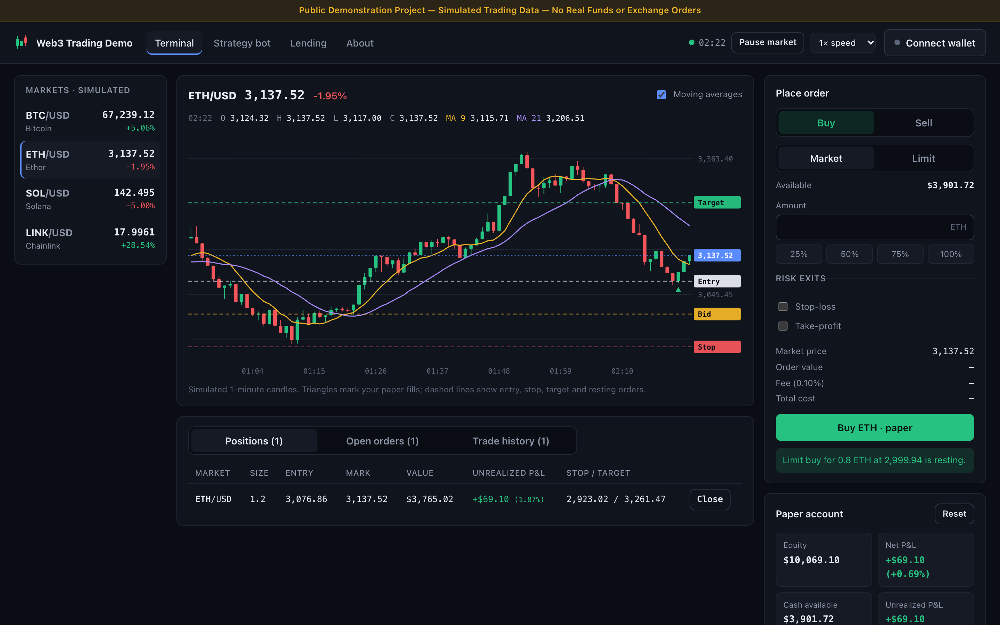
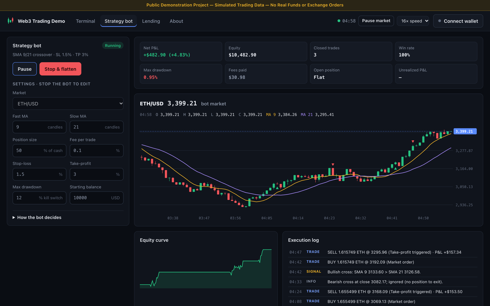
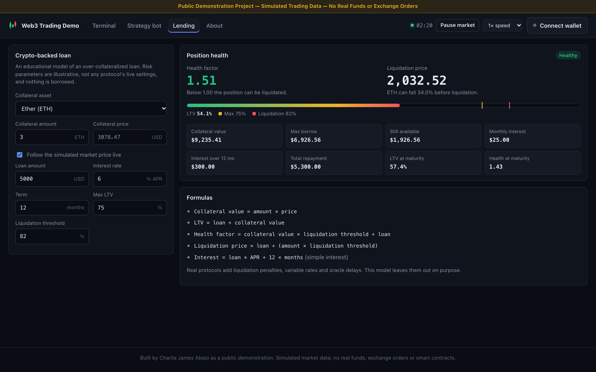

# Web3 Trading Demo

> **Public demonstration project. Simulated trading data. No real funds or exchange orders.**
> Wallet data is real and read-only. Market prices, orders, balances and bot results are simulated.

A paper-trading crypto terminal built with React, TypeScript and ethers.js. It has four parts: a trading terminal with market and limit orders, a rule-based trading bot with risk controls, read-only MetaMask wallet integration, and a crypto-backed loan calculator.

**Live:** https://web3-trading-demo.vercel.app

My earlier Web3 and crypto client work lives in private company repositories that I can't share. This project shows the same kinds of systems in code anyone can read. It is not a client deliverable, and its simulated results are not trading performance.



## Features

### Trading terminal
- Four simulated markets (BTC, ETH, SOL, LINK) with live-updating 1-minute candles, moving-average overlays and an OHLC crosshair readout.
- Market and limit orders, with quick sizing at 25/50/75/100% of what's available.
- Optional stop-loss and take-profit on buys, checked on every tick.
- Positions with average entry, mark price, unrealized P&L and a one-click close.
- Open orders with cancel, and a full trade history with fees and realized P&L.
- A paper account starting at $10,000 with a 0.1% fee per side. It tracks equity, available cash, realized and unrealized P&L, and fees paid.
- Entry, stop, target and resting-order levels drawn on the chart, with markers for each fill.
- Market controls: pause, resume, and 1×, 4× or 16× speed.

### Strategy bot
- A moving-average crossover strategy with configurable fast and slow periods.
- Position sizing as a percentage of available cash, net of fees.
- A stop-loss and take-profit attached to every entry.
- A max-drawdown kill switch that closes the position and halts the bot.
- Start, pause, resume, and stop-and-flatten controls. Settings lock while the bot is trading.
- Live stats: net P&L, equity, closed trades, win rate, max drawdown, fees, open position and unrealized P&L.
- An equity curve, and an execution log of every signal, order, fill and risk event.



### Wallet (real, read-only)
- Connects to MetaMask or any EIP-1193 wallet through ethers.js v6.
- Shows your address, network and native balance, with copy and block-explorer links.
- Follows account and network changes made in the wallet.
- Switches networks between Ethereum, Sepolia, Polygon, Base and Arbitrum One. If the wallet doesn't know a network, it asks the wallet to add it.
- Disconnect revokes the site's permission where the wallet supports it.
- Clear messages when no wallet is installed, a request is rejected, or a request is already pending.
- It never asks for a signature, a transaction, a private key or a seed phrase.

### Lending calculator (educational)
- Choose a collateral asset. Its price can follow the simulated market live.
- Shows LTV, max borrow, health factor, liquidation price, and how far the price can fall before liquidation.
- Projects simple interest: monthly interest, total repayment, and LTV and health factor at maturity.
- The formulas are shown on the page, and the risk parameters are labeled as illustrative.



## What's real and what's simulated

| Feature | Data |
|---|---|
| Wallet address, network, balance, network switching | **Real**, read from your wallet |
| Prices and candles | **Simulated**: a seeded random walk with trend regimes. Starting levels are illustrative, not quotes. |
| Orders, fills, balances, P&L | **Simulated**: a paper account. No exchange is contacted. |
| Bot results | **Simulated**: real rule logic applied to the simulated feed |
| Loan figures | **Educational**: standard formulas with illustrative parameters |

There are no smart contracts in this project.

## Architecture

```
src/
  core/                 Plain TypeScript, no React. All covered by unit tests.
    market.ts           Seeded multi-asset price simulator that builds OHLC candles
    paperAccount.ts     Order matching, fees, cost basis, P&L, stop-loss and take-profit
    bot.ts              MA crossover bot: signals, sizing, protective exits, kill switch
    indicators.ts       SMA, SMA series, crossover detection
    lending.ts          LTV, health factor, liquidation price, interest projection
    random.ts           Seeded PRNG and Gaussian sampling
    format.ts           Number, currency and time formatting
  state/simulation.ts   One clock advances the market, manual account and bot together.
                        React subscribes with useSyncExternalStore.
  wallet/               EIP-1193 + ethers.js v6 hook and supported-chain list
  components/           Terminal, chart (hand-built SVG), order ticket, bot, lending, about
```

**Design decisions**

- **The engine is separate from the UI.** The trading, bot and lending logic are pure TypeScript classes and functions. They can be tested without a browser and could move to a server unchanged.
- **The accounting reconciles.** Cost basis includes buy fees, so realized P&L is net of all fees. Equity always equals starting cash plus realized plus unrealized P&L, and a test checks this.
- **Signals use closed candles only.** The bot never acts on a candle that is still forming, which avoids look-ahead bias. Stops and targets are checked on every tick, so they can fire between candle closes.
- **Fills are realistic, not ideal.** Protective exits fill at the tick that crossed the trigger, so a fast move can fill past the stop. Resting limits fill at their limit price, and limits that are already better than the market fill immediately.
- **Reserved funds.** Open limit buys reserve cash including fees, and open limit sells reserve quantity, so orders can't double-spend.
- **The bot has its own account.** Its stats stay separate from manual trades.
- **No chart library.** Candles, overlays, levels, markers and the crosshair are drawn in SVG. The app's only runtime dependencies are React and ethers.

## Run it

```bash
npm install
npm run dev        # http://localhost:5199
```

```bash
npm test           # Vitest unit tests
npm run build      # type-check, then production build
```

Requires Node.js 20 or later. No environment variables or API keys are needed.

## Testing

34 unit tests cover:
- **Paper account:** market and limit fills, fees, cost basis, P&L reconciliation, reserved cash and quantity, cancels, stop-loss and take-profit triggers, and rejected orders.
- **Bot:** crossover entries and exits, sizing, attached exits, pause behavior, stop-and-flatten, the kill switch and reset, and stats reconciliation. One test runs a 600-candle session and checks the accounting invariants.
- **Market:** determinism, OHLC validity, candle timing and memory caps.
- **Lending:** each formula, interest projection, risk classification and input validation.

I also tested it by hand in a browser: every order type, the bot lifecycle, the wallet through a mock EIP-1193 provider (connect, rejection, account change, network switch, add-network fallback, disconnect), and phone, tablet and desktop layouts.

## Author

Charlie James Abejo · [Portfolio](https://portfoliobboy.vercel.app) · [GitHub](https://github.com/CharlieJamesGwapo)
